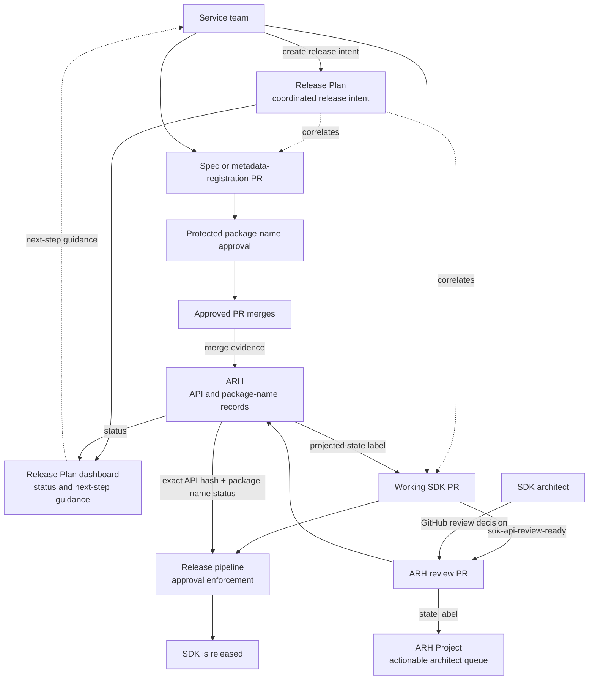
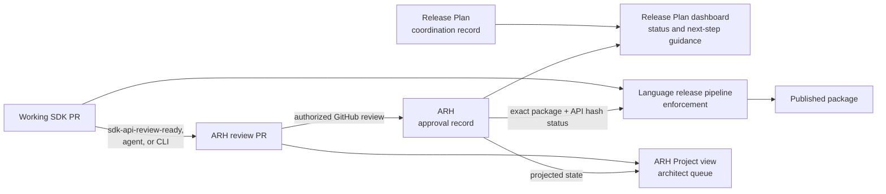
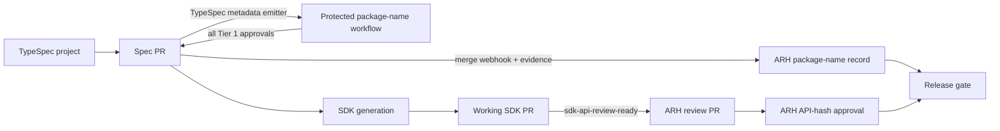
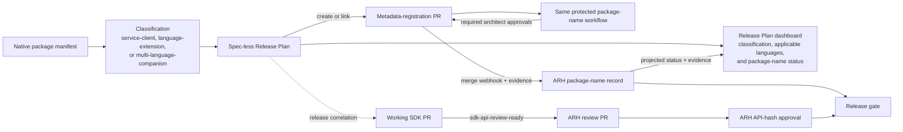
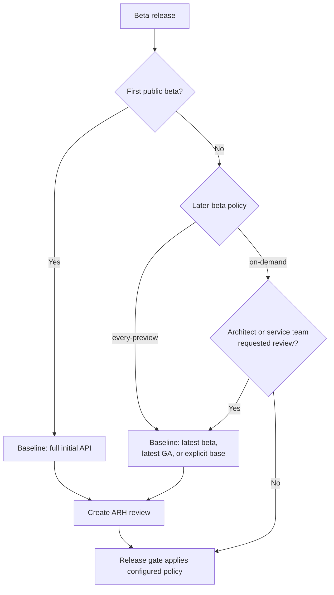
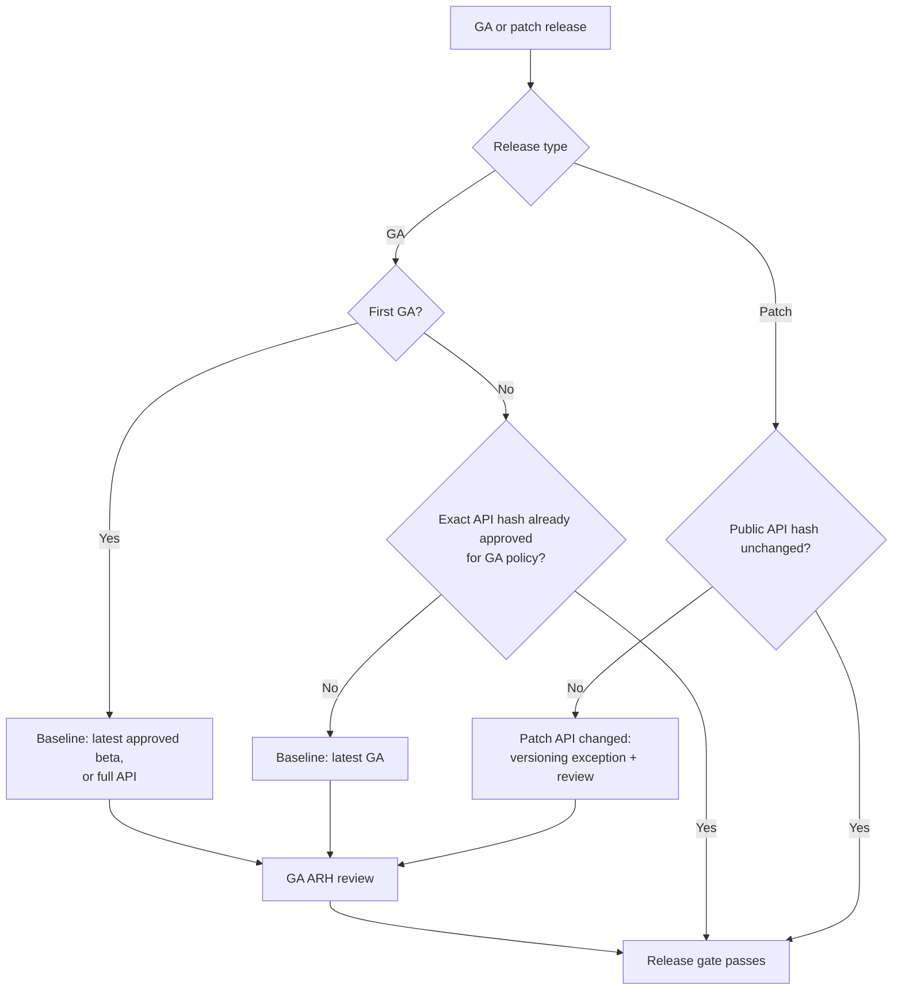
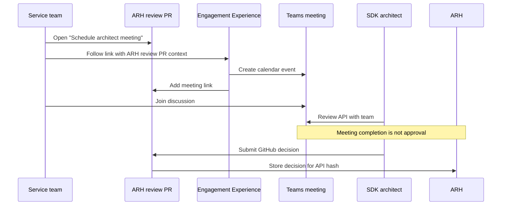

# ARH as the Shared Record for SDK Architecture Approvals

> **Status:** This document separates established behavior from the
> decisions still needed before API Review Hub (ARH) can replace APIView and SDK
> review issue tracking.

---

## Goal

Guide a service team from release intent to a published SDK while ARH becomes the
shared record for SDK API and package-name approvals.

The service team starts with a Release Plan. Its dashboard shows the next action,
such as completing package-name registration, generating or linking a working SDK
PR, requesting SDK API review, addressing architect feedback, or releasing an
approved package. These are informational links and instructions; the dashboard
does not perform or approve the action.

The approval actions remain in the GitHub PR where each review happens:

- Architects approve the SDK API on the ARH review PR.
- Architects approve spec-backed package names on the `azure-rest-api-specs` PR.
- Spec-less packages use a metadata-registration PR in `azure-rest-api-specs` and
  the same protected package-name workflow.

ARH stores both decisions and makes their status available to informational
dashboards and release pipelines. The Release Plan dashboard reports cross-language
release progress but does not initiate, approve, enforce, or own workflow actions.

The working SDK PR uses `sdk-api-review-ready` to request review. After ARH accepts
the request, it removes that trigger and applies the target
`sdk-api-review-needed`, `sdk-api-review-changes-requested`,
`sdk-api-review-approved`, or `sdk-api-review-out-of-date` state to the working and
ARH review PRs. The review PR appears in the architect Project queue. Package-name
status appears as a check, comment, or table rather than another label family.

The new process should:

- show the service team the next release action from the Release Plan dashboard;
- keep release-facing approval records in one place;
- give architects a clear review queue;
- remove duplicate tracking in SDK review issues;
- work for generated and manually written SDKs;
- group related language packages under one service or SDK family;
- show package names that need approval and names approved earlier; and
- block release when required approval is missing.



---

## Terms

- **Working PR:** The SDK pull request that will be merged and released.
- **Review PR:** The pull request created by ARH for reviewing the SDK API. It uses
  temporary branches and does not change the SDK repository.
- **API hash:** An ID for the exact SDK API that was reviewed. If the API changes,
  the old approval no longer applies.
- **SDK review issue:** The current issue in `Azure/azure-sdk` used to collect
  review links, group languages, and show review status.
- **ARH Service and Package:** ARH groups related Packages under a Service.
- **Release Plan:** One coordinated cross-language release occurrence. Its ID may
  correlate artifacts but does not determine approval.
- **Release Plan dashboard:** An informational service-team and release-coordinator
  view. Suggested actions are guidance, not workflow initiation or enforcement.
- **ARH Project view:** The architect queue for ARH review PRs. Its fields and
  labels are projections; the architect decision on the review PR is authoritative.
- **Status label:** A GitHub label such as `sdk-api-review-approved` that shows ARH
  state. The label is not the approval record used for release.
- **P0 decision:** Required before the old review process can be removed.
- **P1 decision:** Required for the complete architect experience but not for basic
  ARH approval storage and release checks.

---

## Outcome and ownership

**Outcome:** A service team can move from release intent to a published SDK without
an SDK review issue, while architects have one review queue and the release
pipeline verifies live ARH approval for the exact API hash.

**Success measures:**

- every release-gated package resolves to one approval provider;
- every required review has a working PR, ARH review PR, API hash, and decision;
- no release relies on a GitHub label or dashboard field as approval;
- spec-backed and spec-less packages use the same normalized package-name contract;
- all required languages are released, explicitly not applicable, or have an
  approved exclusion; and
- the legacy SDK review issue and APIView paths can be retired without losing
  meeting, history, or release-gate coverage.

### Cross-team seams and DRIs

| Seam | Accountable DRI | Owned outcome |
|------|-----------------|---------------|
| Release policy to review initiation | Praveen | A deterministic rule states which releases require review and which baseline the shortcut selects. |
| Working PR review request to ARH review PR | Travis | A label, agent, or CLI creates or returns the correct ARH review PR and links it to the working PR. The release backstop blocks and directs the team to that flow. This is request routing, not reviewer roster management. |
| SDK architect authorization, review state, and Project queue | Travis | ARH validates the reviewer, stores the API-hash decision, adds the review PR to the Project, maintains its managed fields, and projects state labels to the review and working PRs. |
| Spec or native package metadata to package-name approval | Samvaity | Every new package name reaches one protected approval workflow, regardless of metadata source. |
| ARH and APIView migration | Samvaity and Travis | Samvaity owns language cutoffs and final retirement; Travis owns ARH creation, exact-hash decisions, status queries, and integration readiness before each cutoff. |
| ARH approval to release pipeline | Travis | The shared release check returns the live decision for the exact package and API hash; each language pipeline team adopts it. |
| Release Plan scope and spec-less entry | Praveen | Release Planner accepts spec-change, no-spec-change, and spec-less releases and records classification, applicable languages, and package evidence without fake TypeSpec data. |
| Release Plan to service-team guidance | Praveen | The informational dashboard displays correlated ARH state and the next service-team action without becoming a trigger or approval authority. |
| ARH review PR lifecycle | Travis | Request deduplication, target updates, close, cancellation, and repeat requests preserve one clear audit trail. |
| Review PR to live meeting | Engagement Experience owner, name needed | A service team can schedule a meeting linked to the ARH review PR without creating an SDK review issue. |
| Language applicability and exclusions | Justin, or the delegated governance DRI | Every expected language is required, approved for exclusion, or structurally not applicable. |

Contributors may own tasks, but the named DRI remains accountable for the
end-to-end outcome across the handoff. Only the Engagement Experience individual
still needs to be named. The joint ARH and APIView migration has explicit
sub-outcomes: Samvaity owns cutover and retirement; Travis owns ARH readiness.

---

## Approval authority and source of truth

### Today

- APIView is the SDK API approval record used by release pipelines.
- SDK review issue labels such as `<lang>-api-approved` are informational.
- Package-name approval happens on the `azure-rest-api-specs` PR. Protected labels
  and a required GitHub check block the spec PR until required architects approve.

### Target

ARH becomes the shared record used by release pipelines.

For SDK API approval:

- The architect decides on the ARH review PR.
- ARH stores the API hash, decision, architect, language, package, working PR, and
  decision time.

For package-name approval:

- The architect decides on the `azure-rest-api-specs` PR.
- The existing workflow verifies the architect.
- After merge, ARH stores each language's decision on the corresponding Package and
  links to the spec PR as evidence.
- The architect does not approve the package name again in ARH.

SDK API approval applies only to its API hash. A changed SDK API has a new hash and
requires approval. When the hash is unchanged, approval carry-forward follows the
policy configured for that language repository during ARH registration. Languages
can choose different policies.

### Questions and answers

- **Q: What is the authoritative SDK API approval record today?**

  **A:** APIView. SDK review issue labels are informational, and release does
  not consult GitHub or Azure DevOps for SDK API approval.

- **Q: How do release pipelines transition from APIView to ARH?**

  **A:** The target release components use `azsdk` commands that select APIView or
  ARH through explicit package or repository ownership. Current fallback behavior
  is broader and must be tightened before cutover.

- **Q: How does ARH prevent approval from applying after the API changes?**

  **A:** The language repository submits the exact API hash. A changed surface
  produces a different hash, so the approval check fails. ARH can show approved
  hashes to a person, but CI still fails for the unapproved hash.

- **Q: Does APIView also gate directly on the submitted API hash?**

  **A:** Not directly. The APIView release check finds a matching package and
  version. APIView uses the hash internally to copy approval from an older version
  when the API is unchanged. ARH instead requires the release check to submit the
  exact hash.

- **Q: Can an unchanged API hash reuse approval for another package version?**

  **A:** Yes, when allowed by that language repository's ARH policy. A changed
  hash is never approved through carry-forward.

---

<a id="decision-1"></a>

## Decision 1 (P0): How does SDK API review start?

The recommended normal trigger is an `sdk-api-review-ready` label on the working
SDK PR. This works for TypeSpec-generated, otherwise generated, and manually
written SDKs. It means the SDK API is ready for architect review; it does not mean
the release itself is ready.

The label path is a shortcut. It cannot provide every argument accepted by
`azsdk api-review create`, so it uses a standard comparison:

- For the first public beta, show the complete initial API.
- For the first GA, compare against the latest architect-approved beta when one
  exists; otherwise show the complete API.
- For a later GA, compare against the latest GA.
- Post a working PR comment that identifies the selected baseline.
- Direct the user to the Azure SDK agent or `azsdk` command when another baseline is
  needed.

If a team merges without requesting review, the release pipeline is the backstop.
When its approval check finds no approval, it blocks release and directs the team
to request a review through the label, agent, or CLI. After approval, rerunning the
approval job continues the release.

The agent or CLI remains the explicit path for optional intermediate-beta reviews,
unusual baselines, and other custom requests.

Today, authorized CoreAI users can call `azsdk api-review create`. The command
requires:

- language;
- package name;
- target branch;
- optional base tag or ref;
- target owner, which defaults to `Azure`; and
- target repository, which ARH can choose from the language.

Calling ARH again for the same package, base, and target returns the existing open
review instead of creating a duplicate.

| Entry point | Purpose | Status |
|-------------|---------|--------|
| `sdk-api-review-ready` label on the working SDK PR | Normal pre-merge request | Recommended |
| Release pipeline approval check | Mandatory backstop that blocks when approval is missing | Available in shared templates; language rollout is in progress |
| `azsdk` or Azure SDK agent request | Custom baseline, beta, or exceptional flow | Existing explicit path |
| Release Plan dashboard | Display status and suggested next steps | Informational only, never a trigger |
| Automated release flow | Release-time approval check | Recommended; same pattern as the current .NET APIView gate |

### Proposed release policy

This is the complete policy proposed for Praveen's approval:

| Release | SDK API review | Default baseline | Reason |
|---------|----------------|------------------|--------|
| First public beta | New human review required | Full initial API | Architects should review the first public shape before customers build on it. |
| Intermediate beta before GA | New human review on demand | Latest published beta in the same release track, or an explicit base | Beta iteration should remain fast, but an architect or service team can request review. |
| First GA | New human review required | Latest approved published beta in the same release track; full API if none exists | GA is the hardened contract and requires an explicit GA decision. |
| Later GA minor or major | Release gate always; new human review only when no applicable exact-hash approval exists | Latest published GA lower than the target version | Every GA is gated, while unchanged APIs reuse exact-hash approval. |
| Patch | Release gate always; no new human review when the public API hash is unchanged | GA version being patched | A changed public API in a patch is a versioning exception and must block for review. |
| Beta after GA | New human review on demand | Latest published GA, or an explicit base | A beta approval must not silently satisfy a later GA. |

The agent or CLI resolves "latest" to a concrete released tag or ref before it
creates the review and records that exact base on the review occurrence.

First public beta is mandatory in this proposal. For later betas, ARH should support
a per-language or per-package policy with two modes:

- `on-demand`: no automatic review for later betas; and
- `every-preview`: require every later beta when an architect wants continuing
  oversight.

The default for later betas is `on-demand`. Applying `sdk-api-review-ready` or using
the agent or CLI always permits an optional review. The release gate remains
exact-hash based. The current CLI exposes review creation and reports the server's
`appliedInheritanceRule`, but it does not yet expose a command for managing this
later-beta policy. Travis owns adding that ARH configuration contract.

### Questions and answers

- **Q: What is the final label name?**

  **A:** Recommend `sdk-api-review-ready`. `release-ready` is too broad because API
  review is only one release prerequisite.

- **Q: Which release types does the label support?**

  **A:** The proposed standard shortcut supports required first-public-beta and GA
  reviews and optional intermediate or post-GA beta reviews. Patch releases use the
  release gate and need a review only when the public API hash changed. Praveen is
  the approval DRI for this proposed policy.

- **Q: What baseline does a beta label use?**

  **A:** First public beta shows the full API. An optional intermediate beta
  compares to the latest beta by default. Post-GA betas compare to the latest GA.
  The agent or CLI supplies an explicit base for any other comparison.

- **Q: Do management-plane auto-release and other automated flows apply the label,
  call ARH directly, or rely on the release backstop?**

  **A:** They rely on the release approval gate. Ray confirmed that current .NET
  management-plane auto-release checks APIView in the release pipeline, and the new
  shared scripts preserve that pattern for ARH. The automated flow does not need to
  apply a working-PR label. If approval is missing, the gate blocks release and
  directs the service team to request or complete the ARH review. It succeeds after
  approval on rerun.

- **Q: Do no-spec-change and spec-less flows need different review initiation?**

  **A:** No. They use the same working PR label or explicit create operation.
  Release Plan creation and package-name metadata collection need different entry
  paths, but ARH API review does not.

- **Q: Who is authorized to request a review?**

  **A:** Today, anyone in the CoreAI security group can reach the create endpoint.
  Keep that endpoint authorization for the migration. Repository automation may
  call it through its approved workload identity. Reviewer authorization remains a
  separate check against the SDK architect configuration.

- **Q: Who is authorized to cancel or restart a review?**

  **A:** Cancel and restart are not current ARH operations.

- **Q: Who can close a review PR?**

  **A:** Anyone with the required GitHub repository permission.

- **Q: Does a new commit update the existing review or create another one?**

  **A:** A target-branch commit updates the existing review when it changes the API
  diff. It never creates another review.

- **Q: What happens when the same package, base, and target are requested again?**

  **A:** While the review is open, the create endpoint returns it instead of
  creating a duplicate. A request after it closes creates a new review occurrence
  and retains the old PR as history.

- **Q: Is ARH limited to TypeSpec or release-agent SDKs?**

  **A:** No. ARH is independent of TypeSpec and the release agent. Generated,
  manually written, and locally generated paths can use the same create endpoint.

- **Q: What information does a caller have to provide?**

  **A:** Today, language, package name, and target branch are required. The caller
  can also provide a base tag or ref and target owner. ARH can infer the repository
  from the language. The target contract should also accept the working PR URL and
  optional Release Plan ID as correlation metadata.

- **Q: Who produces the API artifact and hash for generated and non-generated
  SDKs?**

  **A:** The language repository controls artifact generation and defines the API
  hash for its language. ARH is not dependent on how the SDK was produced.

- **Q: Who owns failures that prevent creation of a reviewable artifact?**

  **A:** Travis owns the end-to-end ARH outcome and routes defects. The ARH team
  fixes ARH or shared language-independent failures; the language team fixes
  language-specific artifact generation.

- **Q: What is the manual backup when the label's baseline is not correct?**

  **A:** Use the Azure SDK agent or `azsdk api-review create` and supply the desired
  base explicitly.

- **Q: What happens if the team reaches the release pipeline without requesting a
  review?**

  **A:** The approval check fails and tells the team to request or complete the ARH
  review and rerun. The current shared approval-status command checks status; it
  does not create review PRs.

- **Q: Are “review requested” and “release ready” different?**

  **A:** Yes. `sdk-api-review-ready` initiates one required review. Release readiness
  is the combined result of API approval, package-name approval, SDK PR state,
  language completeness, and other release gates. The Release Plan dashboard may
  display that combined state but does not establish it.

All entry points should use the existing create operation. Review PR closing and
reopening behavior is covered in [Decision 6](#decision-6).

### Release Planner correlation

A Release Plan is one coordinated cross-language release occurrence. It may contain
package versions, SDK PRs, API review links, language exclusions, and release
statuses. Its ID is correlation metadata, not the stable identity of a service,
package family, or approval.

- Service clients use the existing ARH Service or Product Service Tree ID as their
  durable grouping.
- Language extensions and companion packages that do not belong to a service use a
  small SDK-family record created for that logical package family.
- Each coordinated release receives a Release Plan ID even when it reuses an API
  version or has no spec change.
- ARH review creation must succeed without the dashboard initiating it.

For example, a Storage Blobs Release Plan is one occurrence that can contain
`Azure.Storage.Blobs`, `azure-storage-blob`, `@azure/storage-blob`, and the related
Java package. The stable grouping is Storage Blobs; the Release Plan ID identifies
this month's coordinated release. A .NET-only
`Azure.Extensions.AspNetCore.Configuration.Secrets` release instead belongs to an
SDK family such as "ASP.NET Core Key Vault Configuration Extension"; it does not
need a fictitious cross-language Azure service.

---

<a id="decision-2"></a>

## Decision 2 (P0): How is package-name approval mapped and reused?

### Current GitHub process

The [package-name review
process](https://github.com/Azure/azure-rest-api-specs/blob/main/.github/workflows/src/package-name-approval/PACKAGE-NAME-REVIEW-PROCESS.md)
runs on the spec PR:

- A workflow finds new or changed package names in `tspconfig.yaml`.
- Initial review requires all applicable Tier 1 language architects.
- If an already configured name changes, all applicable Tier 1 language architects
  reconfirm the cross-language name set.
- The PR comment shows changed names, configured but unchanged names, and languages
  not yet configured.
- Architects approve with protected GitHub labels.
- Management-plane reviews may use the protected `package-name-approved-all` label;
  data-plane reviews use the applicable per-language labels.
- A required check blocks merge until all required approvals are present.
- If an already configured name changes again, all Tier 1 approvals are removed so
  architects reconfirm the complete cross-language set.

This process blocks the spec PR and remains separate from later SDK API review.

### Intended ARH result

The architect continues to approve on the GitHub spec PR. ARH stores the verified
result, and `azsdk package get-approval-status` returns it to the release pipeline.
The existing GitHub check continues to gate the spec PR.

ARH waits for the spec PR merge webhook rather than recording every label event.
After merge, it reads the final per-language approval labels and records each
language's package-name approval on the corresponding ARH Package. Waiting for
merge avoids repeated writes when labels are added, removed, and added again.

The record should include:

- approved status for the language Package;
- a link to the merged spec PR as evidence; and
- enough Package identity to return the approval during release.

Package-name approval is stored on the Package, not a Version. An ARH Package has a
package name, language, and optional parent Service. Package versions are separate.

Existing package-name approvals should be backfilled from APIView. Because those
approvals may predate the GitHub process, their evidence can state that they were
copied from APIView instead of linking to a spec PR.

Azure/azure-rest-api-specs#45677 settled the display and reapproval behavior when
an existing configured name changes:

| Name state in current PR | Display | Current review status |
|--------------------------|---------|-----------------------|
| Changed | Proposed package name | Pending |
| Configured but unchanged | Existing package name | Pending (unchanged) |
| Not configured | Not yet configured | Pending |

When an existing configured name changes, all applicable Tier 1 languages must
approve this complete table. Earlier approvals remain evidence in history but do
not satisfy the new cross-language review. Adding a coordinate for a language that
was previously `Not yet configured` makes that language pending but does not reset
unchanged language decisions.

### Questions and answers

- **Q: Where does package-name approval happen, and where is it stored?**

  **A:** The architect approves by adding the approved label on the
  `azure-rest-api-specs` PR. The durable approval record lives in ARH on the
  corresponding Package.

- **Q: Which event records approval in ARH?**

  **A:** The spec PR merge webhook. ARH then reads the final per-language
  approval labels and records them.

- **Q: Does ARH participate in the spec PR merge check, or only store the result
  for release?**

  **A:** The existing REST API specs workflow continues to gate the spec PR.
  ARH stores the result that the later SDK release gate queries.

- **Q: What fields identify reusable package-name approval?**

  **A:** A package-name approval is identified by:

  1. the package-name review group, such as Storage Blobs or the ASP.NET Core Key
     Vault Configuration extension;
  2. plane and classification;
  3. the complete applicable language set; and
  4. each language's exact registry name, such as NuGet package ID, npm package
     name, PyPI name, or Maven `groupId:artifactId`.

  Store a hash of this normalized set with the revision, plus the per-language
  decisions. Package version and Release Plan ID are not part of the hash. Reuse
  follows these rules:

  - an unchanged coordinate keeps its approval;
  - changing an existing configured coordinate resets all applicable Tier 1
    approvals, matching Azure/azure-rest-api-specs#45677;
  - adding a first coordinate for a previously unconfigured language makes only
    that language pending; and
  - changing plane, classification, or the declared applicability model creates a
    new review whose required decisions are recomputed.

- **Q: How are existing approvals imported into ARH?**

  **A:** Run a migration script that reads package-name approval from APIView.
  The imported record notes APIView as its evidence.

- **Q: When one language's name changes, must all applicable languages approve
  again?**

  **A:** Yes. Azure/azure-rest-api-specs#45677 requires all applicable Tier 1
  architects to reconfirm the complete set when an existing configured package
  name changes. Adding a first name for a previously unconfigured language requires
  that language's approval without discarding unchanged language decisions.

- **Q: If the full set must be reconfirmed, how is old approval displayed?**

  **A:** The current review table shows every row as pending. An unchanged configured
  name is shown as `Pending (unchanged)`, and an unconfigured language is shown as
  `Not yet configured` with pending status. Old approval remains historical
  evidence only.

- **Q: What does an architect approve for a Tier 1 language not configured in
  TypeSpec?**

  **A:** For a spec-backed `service-client`, the architect approves the visible
  cross-language naming direction even when their language says `Not yet
  configured`; this is the behavior shipped by Azure/azure-rest-api-specs#45677.
  For a spec-less `language-extension`, other languages are not applicable and are
  not asked to approve fictitious packages. Release Plan exclusion states are a
  separate concern and must not be used as package-name approval.

- **Q: Does ARH keep an old name's approval after the name changes?**

  **A:** Yes, as immutable audit history linked to the old normalized set. The new
  set remains pending until all required architects approve it. A release check
  evaluates only the current package-name set.

- **Q: Are protected labels still the GitHub approval action?**

  **A:** Yes. The protected per-language labels remain the data-plane approval
  action, and management-plane reviews may use `package-name-approved-all`. ARH
  reads their final state when the spec PR merges.

- **Q: How does the package-name process find the correct ARH Service and Package?**

  **A:** The registration record names one plain-language review group and lists its
  ARH Packages.

  Example for a service client:

  ```text
  Review group: Storage Blobs
  ARH Service: Storage Blobs
  Packages:
    dotnet -> Azure.Storage.Blobs
    java -> com.azure:azure-storage-blob
    python -> azure-storage-blob
    typescript -> @azure/storage-blob
  ```

  Example for a spec-less utility:

  ```text
  Review group: ASP.NET Core Key Vault Configuration Extension
  ARH grouping: SDK family, not an Azure service
  Packages:
    dotnet -> Azure.Extensions.AspNetCore.Configuration.Secrets
  ```

  The workflow looks up the ARH Package by language and exact registry name, then
  attaches it to this review group. "Service" means the stable ARH parent for
  related service-client packages; "SDK family" is the equivalent parent for a
  utility that has no Azure service.

- **Q: How does the release pipeline read package-name approval?**

  **A:** It queries ARH through `azsdk package get-approval-status`, alongside
  SDK API approval.

- **Q: Does a separate package-name dashboard prevent ARH from storing the
  approval?**

  **A:** No. Use a separate package-name Project view because the work occurs on
  spec or metadata-registration PRs and has a different reviewer task from SDK API
  review. ARH remains the release-facing approval store.

- **Q: What evidence is stored with a new package-name approval?**

  **A:** A link to the merged spec or metadata-registration PR.

- **Q: How should a package with no known approval be treated?**

  **A:** Treat it like a new package that still needs package-name approval.

- **Q: What happens when an SDK review is requested for a Package not yet in ARH?**

  **A:** ARH creates the Package and then creates its review PR. Creating the
  Package does not implicitly approve its name.

### Spec-less SDK packages

Spec-less packages should use the same approval workflow with a different metadata
producer:

- spec-backed packages use TypeSpec emitter metadata;
- spec-less packages use native package manifests discovered in the language
  repository; and
- both normalize to a versioned package-name approval request.

The request declares one classification:

| Classification | Applicability | Required reviewers |
|----------------|---------------|--------------------|
| `service-client` | Cross-language service SDK | Architects for all applicable Tier 1 languages |
| `language-extension` | One language's extension or utility | Package-name approvers for the owning language |
| `multi-language-companion` | Declared subset of languages | Architects for the complete declared language set |

Exact package coordinates must include the registry identity, such as Maven
`groupId:artifactId`, not only a display package name. The approval set persists
across Release Plans until its classification, SDK family, intended languages, or
coordinates change.

- **Q: Do spec-less packages require cross-language package-name consensus?**

  **A:** It depends on classification. A `service-client` does; a
  `language-extension` does not create fake Tier 1 counterparts; a
  `multi-language-companion` requires the complete declared language set.

- **Q: How does ARH reliably determine that a package has no associated spec?**

  **A:** It should not infer this from a missing `tsp-location.yaml` or emitter
  configuration. The request must explicitly declare the classification and
  metadata source, and validation must verify the native package coordinates.

- **Q: Where do architects approve spec-less package names?**

  **A:** Use a metadata-only registration PR in `azure-rest-api-specs`, processed by
  the existing protected package-name workflow. The registration contains no fake
  API specification; it only declares the review group, classification, applicable
  languages, and exact package coordinates. This keeps one approval location and
  avoids making ARH API approval implicitly approve a package name. Samvaity owns
  the registration schema and process update.

- **Q: Does SDK API approval also approve the package name?**

  **A:** No. They may be orchestrated for the same release, but they are separate
  architect decisions with separate evidence.

---

<a id="decision-3"></a>

## Decision 3 (P0): Can SDK review issues be removed?

The issue currently:

| Purpose | ARH replacement |
|---------|-----------------|
| Starts review | Decision 1 trigger |
| Collects review links | ARH links the working PR and review PR |
| Groups languages | ARH Service with child Packages |
| Assigns architects | ARH reviewer assignment |
| Shows status | ARH labels and Project view |
| Keeps discussion history | ARH review PR |
| Supports Bookings and meetings | Engagement Experience scheduler linked to the ARH review PR |

The replacement must continue showing:

- service name;
- packages and languages in the review;
- working and review PRs;
- assigned architects;
- status for each package and language;
- supporting links; and
- meeting request and meeting details when needed.

### Questions and answers

- **Q: Is an issue still needed to request review or communicate with the service
  team?**

  **A:** No in the target flow. The working PR initiates review, the ARH review PR
  carries architect discussion, and status is projected to the working PR and
  informational dashboards.

- **Q: Do reviews already scheduled through the old process finish there or move
  into ARH?**

  **A:** Use a per-language cutoff. Reviews already scheduled before that language's
  ARH release gate is enabled finish in the old process. New reviews use ARH after
  the cutoff. Do not move active meeting history between systems. Samvaity owns the
  migration checklist and publishes each cutoff.

- **Q: How does a service team request a live architect meeting after issues are
  removed?**

  **A:** Open Engagement Experience from a "Schedule architect meeting" link on the
  ARH review PR. Engagement Experience receives the ARH review PR URL as its GitHub
  tracking item and writes the meeting link back to that PR. ARH does not call or
  own the scheduler.

- **Q: Where are meeting date, link, agenda, packages, and outcome recorded?**

  **A:** Engagement Experience owns scheduling and Teams meeting details. The ARH
  review PR is the GitHub tracking item and links the meeting. Package, language,
  working PR, Service, and optional Release Plan context come from the ARH review
  PR. API Spec work-item context is optional.

- **Q: Is the final decision after a meeting always stored in ARH?**

  **A:** Yes. A meeting informs the architect decision but does not itself approve
  the API. The architect records the decision on the ARH review PR, and ARH stores
  it against the API hash.

- **Q: Should old issues remain as read-only history?**

  **A:** Recommend yes. Do not migrate historical conversation unless needed for an
  active review.

- **Q: How long do both processes run before new issues stop?**

  **A:** Stop new SDK review issues per language when all four conditions hold:

  1. ARH can create and update that language's review artifact;
  2. its architect roster and labels are configured;
  3. its release pipeline checks ARH; and
  4. Engagement Experience accepts the ARH review PR as the tracking item.

  Existing issues remain read-only or finish in place. Samvaity owns evidence that
  each language meets these conditions.

- **Q: Did the SDK review issue provide an authoritative approval?**

  **A:** No. The issue never had approval capability; its labels were
  informational.

- **Q: Can ARH preserve the service-level grouping currently shown by one
  multi-language issue?**

  **A:** Yes. ARH has a top-level Service with child Packages, so related
  language packages can be grouped under one service.

This direction keeps the dependency one way:

```text
ARH review PR -> user opens Engagement Experience -> scheduler creates meeting
              <- scheduler adds meeting link to the same ARH review PR
```

The current scheduler parses a GitHub tracking URL and is issue-oriented. To remove
the SDK review issue, Engagement Experience must:

- accept `/pull/<number>` as a tracking item, not only `/issues/<number>`;
- rename "GitHub issue" fields to "GitHub tracking item";
- make API Spec work-item context optional;
- read the package and language context from the ARH review PR or prefilled link;
  and
- post the meeting link back to the ARH review PR.

No replacement issue is created. Meeting completion must never imply approval.

Deferred architecture concerns do not require the review PR to stay open. A normal
tracking issue can carry work postponed to a later minor or major release. This is
separate from retaining the current SDK review issue as the review workflow.

---

<a id="decision-4"></a>

## Decision 4 (P1): What appears on the architect dashboard?

The [ARH Project view](https://github.com/orgs/Azure/projects/1018/views/4) is the
cross-repository queue for ARH review PRs. Each item is an ARH review PR from a
language repository.

This is separate from the Release Plan dashboard. They have different roles:

| Surface | Audience | Purpose |
|---------|----------|---------|
| ARH Project view | SDK architects | Actionable queue used to find, filter, and open ARH review PRs |
| Release Plan dashboard | Service teams and release coordinators | Informational view of cross-language release progress and suggested next steps |

Neither surface is an approval record. The Project helps architects navigate to
work, but the architect still decides on the review PR. GitHub events or explicit
`azsdk` operations initiate review, ARH stores approvals, and release pipelines
enforce them. The Release Plan dashboard does not initiate or approve work.

The current Python proof of concept uses `architecture-review-needed`,
`review-out-of-date`, and `api-approved`. Those names should not become the
cross-language contract. `architecture-review-needed` already triggers the Archie
AI reviewer in several SDK repositories, and `api-approved` already exists in
Python.

### Target behavior

Use an ARH-specific label family:

| Review PR label | Meaning in the Project view |
|-----------------|-----------------------------|
| `sdk-api-review-needed` | Waiting for an SDK architect |
| `sdk-api-review-changes-requested` | Waiting for service-team changes |
| `sdk-api-review-approved` | API hash approved |
| `sdk-api-review-out-of-date` | Artifacts are refreshing after the working API changed |

`sdk-api-review-ready` is a separate trigger label used only on the working PR.
After ARH accepts the request, it removes that trigger and projects the current
state label onto the working and review PRs. These labels support filtering and
communication but are not approval records.

ARH can also show package-name approval on both PRs, but it should use a check,
comment, or body table with an evidence link rather than another family of labels.
Architects still perform package-name approval on the spec or metadata-registration
PR.

ARH already groups Packages under a Service. Keep the review PR title package
focused and put Service in an automation-managed Project field.

Architects should not need to open Azure DevOps release-plan work items.

### Questions and answers

- **Q: Is the Service shown in the review PR title, a protected label, or a Project
  field?**

  **A:** Use a managed Project field. For example, the current PR title
  `[API Review] azure-ai-ml 1.35.0 (base 1.34.1)` remains package-focused, while
  the Project fields show:

  ```text
  Service: Azure Machine Learning
  Package: azure-ai-ml
  Language: Python
  Target: 1.35.0
  Baseline: 1.34.1
  Release Plan: 12345 (optional)
  ```

  Multiple language reviews can then share `Service: Storage Blobs` while retaining
  their package-specific titles.

- **Q: How are package-name reviews linked to the ARH Service?**

  **A:** The package-name registration lists the plain-language review group and the
  exact package name for each language. ARH looks up or creates those Packages and
  attaches them to the same Service or utility family. The Storage Blobs and
  ASP.NET Core extension examples in Decision 2 show both cases.

- **Q: Are package-name reviews another view in this Project or a separate queue?**

  **A:** Use a separate package-name Project view. The approval occurs on a spec or
  metadata-registration PR, has cross-language rows, and has a different completion
  rule from one-language SDK API review. Both views still read ARH-backed identity
  and status.

- **Q: What package-name status is shown?**

  **A:** Show `Pending`, `Pending (unchanged)`, `Not yet configured`, or `Approved`
  exactly as the package-name workflow does. For a language extension, omitted
  languages are `Not applicable`, not pending. Release exclusions do not appear in
  this package-name status.

- **Q: Where are production ARH review PRs hosted?**

  **A:** In the language repositories.

- **Q: How can architects filter by language?**

  **A:** The repository can serve as the language because each language has its own
  repository.

- **Q: Do architects need Azure DevOps Release Plan work items?**

  **A:** No. Release Plans are for service teams and release coordination and
  should not be required for architect review.

- **Q: Can the Service name be used to group or filter review PRs?**

  **A:** Yes, through an automation-managed Project field. For example, Python
  `azure-storage-blob` and .NET `Azure.Storage.Blobs` have different review PR
  titles but both filter under `Service: Storage Blobs`.

- **Q: How can multiple reviews for the same Service be distinguished without
  relying on Release Plans?**

  **A:** Use Package, target ref, baseline ref, and API hash. Release Plan ID can be
  shown as optional correlation but is not review identity.

- **Q: Are labels or Project fields used for review-state filtering?**

  **A:** Review PR labels are the current routing and filtering mechanism.

- **Q: How are existing review PRs added to the Project?**

  **A:** The current proof of concept requires them to be added manually. The target
  flow should add them automatically when ARH creates the review.

- **Q: Can package-name approval be shown on review and working PRs?**

  **A:** Yes, after the spec or metadata-registration merge webhook maps the
  approved name set to the ARH Package. ARH can update an informational check,
  comment, or PR-body table on both PRs with the evidence link. This is target
  behavior, not current implementation, and it never replaces the protected-label
  approval action.

- **Q: Can the Release Plan dashboard initiate or approve SDK API review?**

  **A:** No. It may display ARH status and suggested next steps only.

---

<a id="decision-5"></a>

## Decision 5 (P1): What SDK API labels and architect rules are used?

SDK API approval happens on the ARH review PR.

### Target behavior

GitHub review activity triggers an ARH webhook. ARH checks the reviewer, stores the
decision for the API hash, and updates labels.

Only one ARH state label should be present. If the API hash changes,
`sdk-api-review-approved` is removed and the review becomes
`sdk-api-review-out-of-date` until artifacts refresh.

A normal SDK implementation approval is not an API approval. ARH counts only
decisions from an authorized architect on the ARH review PR.

SDK API state labels on ARH review and working PRs are controlled by ARH.
Package-name status uses an informational check, comment, or body table instead of
a label. If someone manually applies an SDK API state label, ARH should remove it
and comment with a link to the correct approval process.

### Questions and answers

- **Q: What are the final SDK API review labels?**

  **A:** Use `sdk-api-review-needed`, `sdk-api-review-changes-requested`,
  `sdk-api-review-approved`, and `sdk-api-review-out-of-date`. Use
  `sdk-api-review-ready` only as the working-PR initiation label.

- **Q: Does any language repository already use those names differently?**

  **A:** No exact collisions were found across the .NET, Java, JavaScript, Python,
  Go, Rust, C++, and iOS SDK repositories. The rejected alternatives do collide:
  `architecture-review-needed` is used by the Archie AI reviewer in several repos,
  and Python already has `api-approved`.

- **Q: Where is the authorized architect list stored?**

  **A:** Use the existing per-language SDK architecture configuration in
  `Azure/azure-sdk/.github/api-review-approvers.yml` as the migration source.
  Package-name authorization remains in
  `Azure/azure-rest-api-specs/.github/protected-labels.yml`.

  The Entra-synchronized `azure-data-plane-api-reviewers` GitHub team is a broader
  data-plane spec-review team. It does not replace the per-language SDK architect
  map. If these rosters are consolidated later, ARH should consume one explicit
  role-to-language map rather than assume every team member approves every SDK
  language.

- **Q: How are backup reviewers handled?**

  **A:** The existing configuration already lists multiple authorized reviewers for
  most data-plane languages and management-plane reviewers who can approve all
  languages. ARH assigns or notifies from that configured set and accepts a GitHub
  approval from any authorized reviewer for the applicable language and plane.
  Roster changes continue through pull requests to the configuration.

- **Q: Where does `changes requested` come from?**

  **A:** Native GitHub review activity triggers an ARH webhook. ARH responds to
  that state and manages the labels.

- **Q: Are labels needed on both the review PR and working PR?**

  **A:** Yes. Review PR labels support architect dashboard filtering. Working
  PR labels communicate the state to the service team.

- **Q: Is a separate `approved-with-comments` state needed?**

  **A:** No. A GitHub approval may include comments, but approval means the API
  is approved. Work intentionally postponed to a future release belongs in a
  tracking issue.

---

<a id="decision-6"></a>

## Decision 6 (P1): When do review PRs close?

ARH keeps one open review PR for the same package, base, and target:

- Repeating the same create request while it is open returns the existing review
  PR.
- A target-branch commit updates the review only when the SDK API diff changes.
- After the review closes, repeating the request creates a new review occurrence.
- The request can specify the release tag or ref used for comparison.
- GitHub preserves review comments.
- A person with GitHub permission can close the review PR.
- Merging the temporary review branches has no effect on SDK code, so the review PR
  should be closed instead.

Reviews should remain on demand by default. Keeping a permanent review open for
every Package would create too many PRs and cause broad repository changes to
refresh many reviews at once.

ARH supports multiple reviews with the same target and different baselines. A
target update refreshes each review whose API diff changes. ARH should not close the
other reviews automatically because an architect may intentionally compare the same
target against the latest GA and latest beta.

Putting several baseline comparisons into one review PR was also explored but is
not the preferred design. It makes the version being reviewed less obvious and
requires substantial changes to the review artifact.

The preferred lifecycle is:

- A review targeting a working branch closes automatically when that branch merges.
- A review targeting `main` remains open until someone closes it manually.
- Closing a review deletes its synthetic branches.
- A long-running `main` review may be created by an architect for a small number of
  problem services, but it is not the default workflow. It uses a released version
  as the base and updates as package changes merge into `main`.

### Questions and answers

- **Q: Can the review PR be merged?**

  **A:** Technically yes, but it only merges the review branch into a synthetic
  base branch. It does not change SDK code, and both temporary branches are
  eventually deleted.

- **Q: Does each target branch keep one review PR as feedback is addressed?**

  **A:** Yes. Changes pushed to the target branch update the existing review PR
  when they change the API diff.

- **Q: What identifies the baseline for the API diff?**

  **A:** The caller supplies the base tag or ref. A skill or agent may infer it
  on the caller's behalf.

- **Q: How are review comments preserved when the API diff changes?**

  **A:** GitHub preserves them on the existing review PR.

- **Q: Does APIView remain after the ARH and APIView migration?**

  **A:** No. APIView is retired after every language is onboarded to ARH and the
  release-gate cutover is verified.

- **Q: Are reviews on demand or permanently open for every Package?**

  **A:** On demand by default. Long-running reviews are an exceptional option
  for selected services.

- **Q: What happens when several reviews use different baselines but the same
  target?**

  **A:** They remain separate, and a target change updates each affected
  review. Approval of the target API hash satisfies the approval check regardless
  of which baseline review produced it.

- **Q: How are concerns deferred to a later release preserved?**

  **A:** Use a tracking issue rather than keeping every review PR open or
  creating an `approved-with-comments` state.

- **Q: Is working-branch merge the final automatic close event?**

  **A:** Yes, after ARH has stored the final decision and detached synthetic
  branches. Travis owns idempotent event ordering and retries.

- **Q: What should ARH do if someone manually closes a pending review?**

  **A:** Mark the review occurrence cancelled, delete its synthetic branches, and
  update the working PR. Cancellation never counts as approval.

- **Q: Should requesting the same package, base, and target reopen a closed review
  or return it as closed?**

  **A:** Create a new review occurrence and retain the closed PR as history. Do not
  reopen a closed review because that blurs the audit trail.

---

<a id="decision-7"></a>

## Decision 7 (P0): How does Release Planner support spec-less packages?

### Current behavior

Release Planner and its dashboard are TypeSpec-first:

- `azsdk_create_release_plan` requires a TypeSpec project path and API release type;
- duplicate lookup and product resolution use the TypeSpec project path;
- the dashboard creation guide asks for a TypeSpec project path; and
- the dashboard model has TypeSpec, product, service, release, and per-language
  package fields, but no metadata-source or package-classification field.

The dashboard can already enrich a language package with package-name and API review
status from its Package work item. It cannot currently explain that a package is
spec-less or why only a subset of languages applies.

### Target process

Release Planner supports three explicit entry paths:

| Entry path | Spec prerequisite | Package metadata source |
|------------|-------------------|-------------------------|
| `spec-change` | Active spec PR and project path | TypeSpec emitter |
| `no-spec-change` | Existing service/spec association, no new spec PR | Existing package data plus native manifest verification |
| `spec-less` | None | Native package manifest and explicit classification |

A spec-less Release Plan starts from native package metadata, release month and
type, and a stable review group. Release Planner creates or links the package-name
metadata-registration PR and tracks its pending or approved state. It does not
create a fake TypeSpec path or API Spec work item. The declared classification and
language coordinates create only the applicable language rows.

The Release Plan stores these concepts:

| Concept | Why it is needed | Dashboard presentation |
|---------|------------------|------------------------|
| Entry path | Distinguishes spec-backed, no-spec-change, and spec-less flows | `Spec-backed`, `No spec change`, or `Spec-less` badge |
| Review group or SDK family | Provides stable grouping when no Product Service Tree service exists | Readable service or SDK-family name |
| Package classification | Determines applicable languages | `Service client`, `Language extension`, or `Multi-language companion` badge |
| Metadata source and evidence | Links TypeSpec metadata or native manifest to the occurrence | Details link, including the metadata-registration PR |
| Applicable language coordinates | Identifies the packages coordinated by this occurrence | Existing per-language package table |
| Package-name approval state | Tells the service team what is still pending | Existing package status area linked to approval evidence |

Classification should be visible because the dashboard is service-team guidance. It
explains why a .NET-only language extension has one required row while a service
client expects all applicable Tier 1 languages. It is display and coordination
context, not approval authority. For a spec-less occurrence, the dashboard skips
the API Spec stage and starts guidance from package-name registration, SDK PR, and
release state.

This is a proposed extension for Praveen's approval. Approval is needed for the
Release Planner entry contract, new stored fields, applicability behavior, and
dashboard presentation.

### Questions and answers

- **Q: Does Release Planner support spec-less package releases today?**

  **A:** No. The current create operation and dashboard guidance require a TypeSpec
  project path. The target adds `spec-less` as an explicit entry path rather than
  overloading the TypeSpec field.

- **Q: Should package classification appear on the Release Plan dashboard?**

  **A:** Yes. Show a readable classification and `Spec-less` badge so service teams
  understand which languages are expected and why. The dashboard displays the
  Release Plan record; it does not decide or approve the classification.

- **Q: Is package classification the same as Release Plan type?**

  **A:** No. Release Plan type remains the lifecycle value such as Private Preview,
  Public Preview, or GA. Package classification describes applicability:
  `service-client`, `language-extension`, or `multi-language-companion`.

- **Q: What starts a spec-less Release Plan?**

  **A:** The service team or agent supplies the stable review group or SDK family,
  classification, native package coordinates, release month, and release type. It
  also supplies an existing metadata-registration PR or asks Release Planner to
  create one. TypeSpec project and API Spec PR are not required.

- **Q: Should a spec-less Release Plan show package-name approval?**

  **A:** Yes. Show the status and evidence from the metadata-registration PR using
  the same package status area used for spec-backed packages. The protected
  package-name workflow remains the authority.

- **Q: Does a spec-less Release Plan show an API Spec stage?**

  **A:** No. The dashboard skips that stage and must not report a missing TypeSpec
  path or API Spec work item as an error.

- **Q: Does every coordinated SDK release require a Release Plan?**

  **A:** Yes in the target design. A Release Plan is the coordination record for
  every public SDK release occurrence covered by this flow, including spec change,
  no-spec-change, handwritten, utility, and patch releases. Its scope can contain
  one language for a language extension or several languages for a service client.

- **Q: What identifies a Release Plan after TypeSpec project plus API version is
  relaxed?**

  **A:** The existing Release Plan work-item ID identifies the release occurrence.
  Product Service Tree ID or ARH Service identifies the stable service across
  occurrences. A utility with no service gets an SDK-family ID. API version, package
  versions, TypeSpec path, and Release Plan type are attributes, not identity.

  Example:

  ```text
  Stable group: Storage Blobs (Product Service Tree ID / ARH Service)
  Occurrence: Release Plan 12345
  Attributes: API 2026-08-01, .NET 12.27.0, Python 12.26.0

  Stable group: ASP.NET Core Key Vault Configuration Extension (SDK-family ID)
  Occurrence: Release Plan 12346
  Attributes: .NET 1.5.0, spec-less, language-extension
  ```

- **Q: Is a Release Plan package-specific?**

  **A:** No. It represents a coordinated release across applicable languages and
  contains per-language package, PR, exclusion, and release state.

- **Q: What are the allowed language states?**

  **A:** Required, exclusion requested, exclusion approved, or not applicable by
  classification. `MissingEmitterConfig` is a condition on a required language,
  not an approved exclusion.

- **Q: Who approves language exclusions?**

  **A:** Justin, or the person formally delegated that release-governance role.
  The Release Plan work item stores the approver, reason, time, and affected
  occurrence rather than coupling the record only to a person's name.

- **Q: Can the informational dashboard omit a language because emitter
  configuration is missing?**

  **A:** No in the target design. The language remains required until its emitter is
  configured or an exclusion is approved.

- **Q: Which system owns and enforces cross-language completeness?**

  **A:** The Release Plan work item is the coordination record for required,
  excluded, not-applicable, and released languages. The dashboard only renders that
  record. Individual language release pipelines enforce approval for the package
  they publish; they do not wait for every other language to publish. Praveen owns
  the coordination policy, and Justin or the delegated governance DRI owns
  exclusion decisions.

---

## Proposed release pipeline contract

[#16660](https://github.com/Azure/azure-sdk-tools/pull/16660) merged the shared
release-check scripts and templates. It did not wire them into every existing
language pipeline, so the primitives are available but the following end-to-end
contract is not yet universally deployed:

1. Each language pipeline runs `azsdk package get-approval-status` at its existing
   approval-check step.
2. ARH-enabled package information includes the exact API hash.
3. During migration, a package without an ARH hash is checked in APIView.
4. The pipeline fails when approval is missing or cannot be checked.
5. `Skip.CheckPackageApproval` is the authorized emergency override.
6. After publishing, `azsdk package mark-released` records the release.

APIView is removed after all languages are onboarded to ARH. If ARH is unavailable
afterward, release uses the authorized break-glass override.

The target ARH result combines required SDK API and package-name approval.

### Questions and answers

- **Q: Which system enforces SDK API approval for release?**

  **A:** The language release pipeline should call the shared
  `azsdk package get-approval-status` command added by #16660.

- **Q: What system computes the API hash?**

  **A:** Each language repository owns API artifact generation and defines the
  hash for that language.

- **Q: Does the release pipeline read both APIView and ARH during migration?**

  **A:** Through a migration abstraction, yes, but a package or repository must have
  one explicit owner. APIView fallback should occur only for packages not yet owned
  by ARH, not after an ordinary ARH non-approval or error.

- **Q: What ends the ARH and APIView migration period?**

  **A:** All required languages and package classes are onboarded, pipeline gates
  are deployed and verified, Travis confirms ARH meets the readiness checklist,
  and Samvaity confirms no release depends on APIView.

- **Q: What happens when ARH is unavailable after APIView is retired?**

  **A:** An authorized, audited break-glass override can unblock the release.

- **Q: Is approval required before the working PR merges, before release execution,
  or both?**

  **A:** Request and complete review before the working PR merges in the normal
  flow. The release pipeline independently checks live approval and is the mandatory
  enforcement point. If pre-merge review was skipped, release blocks until the team
  requests and completes review.

- **Q: Which release types require architecture review: first preview, preview
  update, first GA, GA update, and patch?**

  **A:** Use the policy in Decision 1: first public beta and first GA require review;
  intermediate and post-GA betas are on demand; later GA releases require a new
  human decision only when the exact API hash is not already approved; unchanged
  patches reuse approval, while changed patch APIs block as versioning exceptions.

This proposed policy is ready for Praveen's approval. It intentionally adds first
public beta review to the current broader workflow, which today requires package
name approval but not SDK architecture review for first preview. ARH's exact-hash
model and inheritance response support reuse decisions, but the current `azsdk` CLI
does not expose preview-policy management. Travis owns that configuration surface.

---

## Scope boundary

The process has three separate review groups:

1. Breaking Change Board
2. Stewardship Board
3. SDK Architecture Board

This work replaces the SDK Architecture Board's APIView and SDK review issue flow.
It stores package-name decisions in ARH but does not move the package-name approval
action away from the GitHub spec or metadata-registration PR.

| ARH covers | Separate process |
|------------|------------------|
| SDK public API review | Data-plane specification review by the Stewardship Board |
| SDK API review PR | Breaking-change approval |
| SDK architect assignment and decision | ARM and other specification review |
| API approval for the exact API hash | General SDK code review |
| Package-name approval record | Package-name approval action on the spec or metadata-registration PR |
| SDK Architecture Board dashboard | Other release approvals |

This boundary is settled. Stewardship and Breaking Change review remain separate.

---

## End-to-end component flows

<details>
<summary><strong>Show end-to-end component flows</strong></summary>

### Shared authority and information flow



The dashboards display state. The ARH review PR is where the architect decides,
ARH stores the decision, and the release pipeline enforces it. Release Plan
correlation may be included in the check result, but the dashboard is not a
release-gate input.

### Spec-backed package



Package-name approval and SDK API approval are separate decisions. Changing an
existing configured package name resets all applicable Tier 1 approvals for the
complete visible name set. Adding a first name for a previously unconfigured
language makes that language pending without resetting unchanged decisions.

### Spec-less package



The classification determines applicable languages. A .NET-only language extension
does not create fake Java, Python, or TypeScript package-name approvals. The
dashboard guides the service team through the plan but does not approve the
classification or package name.

### First beta and intermediate beta



First public beta review is required by the proposed policy. Later beta review is
optional unless an architect selects continuing preview oversight.

### GA and patch



Every GA reaches the approval gate. Human review is not repeated for an unchanged
hash that policy allows to inherit. A changed patch API is never silently released.

### Live meeting without an SDK review issue



Engagement Experience links to the ARH review PR. ARH does not integrate with or
invoke the scheduler, and no SDK review issue is created.

</details>
